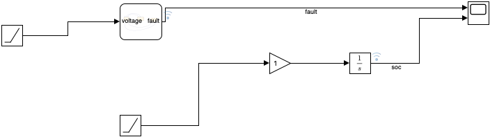
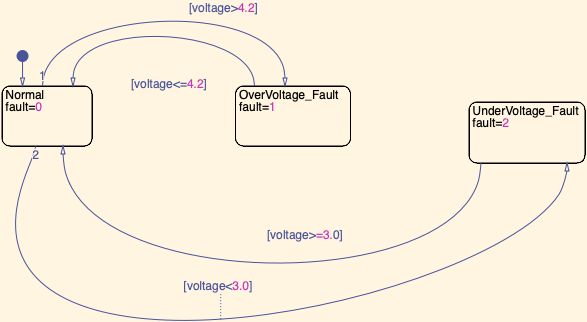

# Automotive BMS Model-Based Design (MBD) & CAN Telemetry Portfolio

End-to-end automotive engineering portfolio covering **Simulink/Stateflow BMS control modeling**, **automated Model-in-the-Loop (MIL) verification**, **V-Model & ISO 26262 functional safety mapping**, and **Python CAN bus telemetry decoding**.

## Repository Structure

### 1. `simulink-bms-mil/`
* **`BMS_Protection_SoC.slx`**: Simulink & Stateflow Battery Management System protection logic (Normal `0`, Warning `1`, Fault `2`) and coulomb-counting SoC estimation.
* **`run_bms_mil_tests.m`**: Automated MATLAB MIL batch test runner evaluating nominal, over-voltage, under-voltage, and over-current scenarios.
* **`bms_mil_results.csv` / `.mat`**: Exported MIL verification logs.
* **Additional Vehicle Control Models**: `Stateflow_Transmission_Logic.slx`, `Vehicle_Cruise_Control.slx`, and `ABS_Simulation_Completed.slx`.

### 2. `vmodel-iso26262/`
* **`day14_vmodel_mapping.md`**: V-Model traceability matrix linking system requirements, Simulink/Stateflow design, and automated MIL verification.
* **`day15_iso26262_safety.md`**: ISO 26262 safety goals, ASIL classification, and safe-state fault reaction mapping.

### 3. `can-bms-telemetry/`
* **`bms_telemetry.dbc`**: Custom CAN database defining `BMS_Status` (`0x100`) and `BMS_SoC_Fault` (`0x200`).
* **`parse_can_log.py` & `decode_bms_can.py`**: Python utilities using `cantools` and `pandas` to parse raw CAN logs and decode physical signals.
* **`analyze_bms_telemetry.py` & `bms_telemetry_plot.png`**: Automated time-series alignment, voltage/fault pass-fail validation, and diagnostic plotting.

## Quick Start (Python Telemetry)
```bash
cd can-bms-telemetry
python3 -m venv .venv && source .venv/bin/activate
pip install -r ../requirements.txt
python analyze_bms_telemetry.py

```

## Model Architecture & Stateflow Logic

### Top-Level BMS Protection & SoC Model


### Stateflow Fault-Protection State Machine

